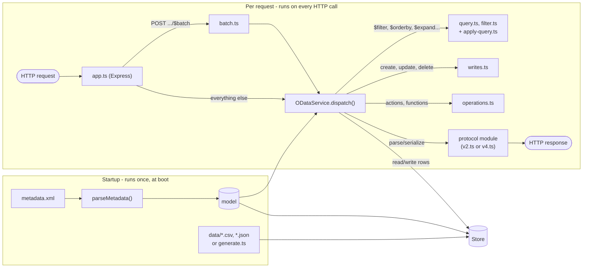

# Architecture



One model, parsed once at startup, backs a V2 service and a V4 service sharing the same in-memory `Store`. Each protocol module only knows how its own wire format looks (literals, JSON envelope, query option names); `service.ts` walks the resource path and follows navigations, protocol-agnostically, handing each part of the work to its own module: the path and its keys to `resource-path.ts`, query options to `apply-query.ts`, creates, updates and deletes to `writes.ts`, actions and functions to `operations.ts`, and drafts to `draft.ts`.

The sources are TypeScript, in `lib/`; `model.ts` describes the model they all share. `yarn build` compiles them to `dist/`, which is what the npm package and the Docker image run. The tests run on the sources directly (Node 22.18 or later strips the types).

## Using it in code

The package exports the Express app, with its TypeScript types, so you can start it from a test or mount it in your own server:

```js
import { createApp } from "odata-prova";

const { app } = createApp({
  modelDir: "./MySrv",
  v2Path: "/odata/v2/MySrv", // a falsy path disables that protocol
  v4Path: "/odata/v4/MySrv",
  mockRows: 20, // default 0: only the data files
  etags: "strict", // default "lenient", see docs/odata-support.md#etags
  joins: "strict", // default "guess", see docs/odata-support.md#navigations-without-a-referentialconstraint
  pageSize: 100, // default 0: every row, see docs/odata-support.md#server-driven-paging
});
app.listen(3000);
```

That is the package's whole API: `odata-prova` exports `createApp`, `findModelDir`, `ETAG_MODES` and `JOIN_MODES`, and their types (`AppOptions`, `ETagMode`, `JoinMode`). Its other files are internal and may change in any release, so `package.json`'s `exports` doesn't let them be imported: `import ... from "odata-prova/dist/lib/metadata.js"` fails with `ERR_PACKAGE_PATH_NOT_EXPORTED`.

## Possible future improvements

- **Draft validation** - drafts are activated as they are: no validation messages, side effects, or locks between users.
- **Richer operation rules** - rules can only set fixed values; conditions, computed values or creating entities would need more.
- **Navigations without foreign keys** - a single-valued link with no foreign key (TripPin's `Person.Photo`) gets a hidden key of its own, but a many-to-many link (`Person.Friends`), a collection with no navigation back (`Trip.Photos`) and a contained target (`ContainsTarget`, `Person.Trips`) are disabled. Many-to-many needs a link set between the two sides; containment an internal entity set keyed by the parent, exposed in V2 as a regular set.
- **Persistent storage** - swap the in-memory `Store` for a real database.

## References

Specs and docs used for implementing the metadata parser, $filter, $expand, and $batch:

- [OData Version 2.0](https://www.odata.org/documentation/odata-version-2-0/) - odata.org docs (metadata, URI conventions, JSON format)
- [OData Version 4.01, Part 1: Protocol](https://docs.oasis-open.org/odata/odata/v4.01/odata-v4.01-part1-protocol.html) - OASIS standard
- [OData CSDL XML Representation, Version 4.01](https://docs.oasis-open.org/odata/odata-csdl-xml/v4.01/os/odata-csdl-xml-v4.01-os.html) - the $metadata XML format for V4
- [SAP Annotations for OData Version 2.0](https://sap.github.io/odata-vocabularies/docs/v2-annotations.html) - `sap:` namespace attributes (label, display-format, content-version, etc.)
