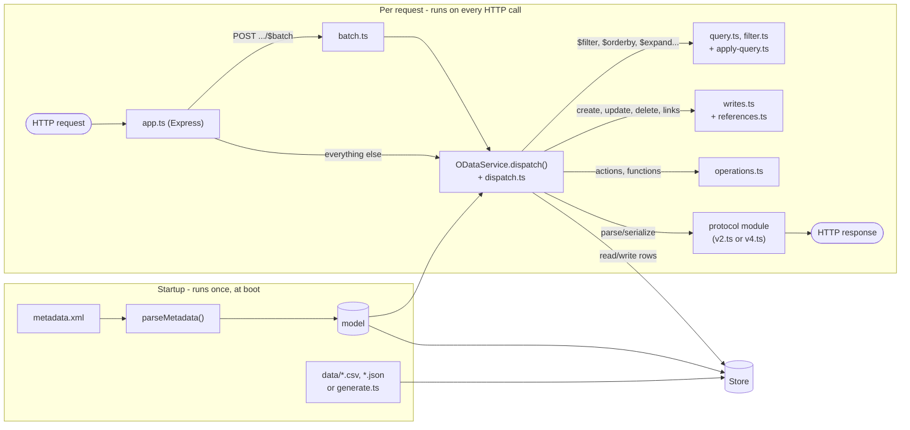

# Architecture



One model, parsed once at startup, backs a V2 service and a V4 service sharing the same in-memory `Store`. Each protocol module only knows how its own wire format looks (literals, JSON envelope, query option names); `dispatch.ts` walks the resource path and follows navigations, protocol-agnostically, and hands each part of the work to its own module. `service.ts` keeps what they all share: the model's lookups, navigations, and a collection's response.

| Module                                                                           | What it does                                                        |
| -------------------------------------------------------------------------------- | ------------------------------------------------------------------- |
| `app.ts`, `batch.ts`                                                             | the Express app: routes, CORS, `$batch`, errors outside the service |
| `service.ts`, `dispatch.ts`                                                      | a request from its path to its answer                               |
| `protocol.ts`, `protocols/v2.ts`, `protocols/v4.ts`                              | each protocol's literals, query options and responses               |
| `metadata.ts`, `navigations.ts`, `operation-views.ts`                            | reading `metadata.xml` into the model                               |
| `emit.ts`, `emit-v2.ts`, `emit-v4.ts`, `annotations-v2.ts`, `sap-annotations.ts` | the `$metadata` of the protocol the document wasn't written in      |
| `resource-path.ts`, `query.ts`                                                   | the path and its keys, the query options                            |
| `filter.ts`, `apply-query.ts`, `compute.ts`                                      | `$filter`, `$orderby`, `$search`, `$top`, `$skip`; `$compute`       |
| `apply-parse.ts`, `aggregation.ts`, `aggregates.ts`, `hierarchy.ts`              | `$apply`: parsing, running, aggregate values, hierarchies           |
| `paging.ts`, `delta.ts`                                                          | server-driven paging, delta links                                   |
| `writes.ts`, `references.ts`, `links.ts`                                         | creates, updates, deletes; links between entities; link sets        |
| `operations.ts`, `draft.ts`, `etag.ts`                                           | actions and functions, drafts, ETags                                |
| `store.ts`, `generate.ts`, `mock-data.ts`                                        | the rows and their transactions; data files, generated mock data    |
| `types.ts`, `model.ts`                                                           | Edm values, the model's types                                       |

The sources are TypeScript, in `lib/`; `model.ts` describes the model they all share. `yarn build` compiles them to `dist/`, which is what the npm package and the Docker image run. The tests run on the sources directly (Node 22.18 or later strips the types).

## Writes and transactions

The `Store` is the only thing that changes rows. Every change goes through `store.insert`, `store.update` or `store.remove`; the rows are private to it, and `rows()` and `lookup()` hand them out as read-only arrays, so a `push` or `splice` from outside is a compile error. Rows change in place: a module keeps the row object it found, and sees what the store writes into it.

Each change made inside a transaction is logged with what it takes to undo it, and a rollback replays the log backwards:

```ts
const mark = store.begin();
try {
  // ... changes through the store
  store.commit(mark);
} catch (e) {
  store.rollback(mark);
  throw e;
}
```

- **Every request is a transaction.** `ODataService.dispatch()` begins one, commits it when the request succeeds, and rolls it back when the request throws or its response is a status of 400 or more. A request that fails leaves the data as it found it, whatever it had changed before failing. A handler that changes rows and then answers with an error loses those changes, by design.
- **Transactions nest.** A `$batch` changeset is one, and each of its requests one inside it, so a failing request rolls back the whole changeset; a draft action (`draft.ts` `atomic()`) and a deep insert (`writes.ts` `create`) are one inside their request's. An inner rollback undoes only its own changes; an inner commit keeps them for the outer transaction to keep or undo.
- **Only the logged changes are undone.** Nothing is copied: the log holds the rows and the old values of the fields that changed, so a transaction costs what it touches, not what the store holds.
- **Navigations use an index.** `store.lookup()` finds the rows of a set whose columns hold given values, for `related()` and `$expand`, from an index built on first use. The store drops an index whenever a change could make it wrong, which it can tell because every change goes through it.

**A change that bypasses the store** (`row.X = ...` on a row of the store) compiles, but escapes rollback. The tests catch it: `test/helpers.ts` turns on `store.audit`, which checks at the end of every transaction that undoing its log gives back the data as the transaction found it. New code that changes a row uses `store.update(setName, row, changes)`.

## Using it in code

The package exports the Express app, with its TypeScript types, so you can start it from a test or mount it in your own server:

```js
import { createApp } from "odata-prova";

const { app } = createApp({
  modelDir: "./MySrv",
  v2Path: "/odata/v2/MySrv", // a falsy path disables that protocol
  v4Path: "/odata/v4/MySrv",
  mockRows: 20, // default 0: only the data files
  etags: "strict", // default "lenient", see docs/odata-support.md#etags
  joins: "strict", // default "guess", see docs/odata-support.md#navigations-without-a-referentialconstraint
  pageSize: 100, // default 0: every row, see docs/odata-support.md#server-driven-paging
});
app.listen(3000);
```

That is the package's whole API: `odata-prova` exports `createApp`, `findModelDir`, `ETAG_MODES` and `JOIN_MODES`, and their types (`AppOptions`, `ETagMode`, `JoinMode`). Its other files are internal and may change in any release, so `package.json`'s `exports` doesn't let them be imported: `import ... from "odata-prova/dist/lib/metadata.js"` fails with `ERR_PACKAGE_PATH_NOT_EXPORTED`.

## Possible future improvements

- **Draft validation** - drafts are activated as they are: no validation messages, side effects, or locks between users.
- **Richer operation rules** - rules can only set fixed values; conditions, computed values or creating entities would need more.
- **Persistent storage** - writes that survive a restart: each committed transaction saved to a file, opt-in, with the store in memory still answering every query.

## References

Specs and docs used for implementing the metadata parser, $filter, $expand, and $batch:

- [OData Version 2.0](https://www.odata.org/documentation/odata-version-2-0/) - odata.org docs (metadata, URI conventions, JSON format)
- [OData Version 4.01, Part 1: Protocol](https://docs.oasis-open.org/odata/odata/v4.01/odata-v4.01-part1-protocol.html) - OASIS standard
- [OData CSDL XML Representation, Version 4.01](https://docs.oasis-open.org/odata/odata-csdl-xml/v4.01/os/odata-csdl-xml-v4.01-os.html) - the $metadata XML format for V4
- [SAP Annotations for OData Version 2.0](https://sap.github.io/odata-vocabularies/docs/v2-annotations.html) - `sap:` namespace attributes (label, display-format, content-version, etc.)
